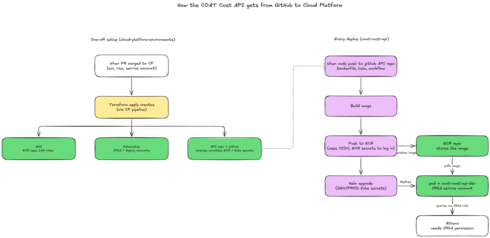

# Deploying the COAT Cost API to Cloud Platform

This doc explains how the COAT Cost API is deployed to the MOJ Cloud Platform, how to release it, and how to check a deployment is working.

It follows on from [Creating the Cloud Platform namespace](create-cloud-platform-namespace.md)

## Contents

- [Overview](#overview)
- [Cloud Platform resources](#cloud-platform-resources)
- [GitHub secrets and variables](#github-secrets-and-variables)
- [The Docker image](#the-docker-image)
- [The Helm chart](#the-helm-chart)
- [Deploying to dev](#deploying-to-dev)
- [Releasing to prod](#releasing-to-prod)
- [Checking a deployment](#checking-a-deployment)
- [Troubleshooting](#troubleshooting)


## Overview

The API runs in two Cloud Platform namespaces:

| Environment | Namespace | How it gets deployed |
| --- | --- | --- |
| Dev | `coat-cost-api-dev` | Automatically on every merge to `main` |
| Prod | `coat-cost-api-prod` | When a `v*` version tag is pushed (for example `v0.1.0`) |



There are two halves to the setup:

**One-off setup (in `cloud-platform-environments`)**

1. A PR (reviewed by ask-cloud-platform) adds Terraform files (`ecr.tf`, `irsa.tf`, `serviceaccount.tf`) to the namespace.
2. When it merges, the Cloud Platform pipeline runs `terraform apply`
3. That creates the AWS resources (ECR repo, IAM roles), the Kubernetes service accounts and writes the secrets and variables our pipeline needs straight into this repo. **Nobody adds those by hand.**

**Every deploy (in this repo)**

1. GitHub Actions builds the Docker image, tagged with the commit SHA.
2. It logs into AWS with OIDC and pushes the image to ECR.
3. It connects to the cluster with the deploy service account and runs `helm upgrade --install`.
4. Kubernetes pulls the image and starts the pod, running as the IRSA service account.

## Cloud Platform resources

Each namespace in [`cloud-platform-environments`](https://github.com/ministryofjustice/cloud-platform-environments) has these files under `namespaces/live.cloud-platform.service.justice.gov.uk/<namespace>/resources/`:

| File | Module | What it creates |
| --- | --- | --- |
| `ecr.tf` | cloud-platform-terraform-ecr-credential  | An ECR repo for the image, and an IAM role gitHub Actions can assume with OIDC to push to it. Writes the ECR secrets and variables to this repo. |
| `irsa.tf` | cloud-platform-terraform-irsa | A Kubernetes service account (`coat-cost-api-dev` / `coat-cost-api-prod`) linked to an IAM role. This is the AWS identity the running pod uses.  |
| `serviceaccount.tf` | cloud-platform-terraform-serviceaccount | A deploy service account (`cd-serviceaccount`) that GitHub Actions uses to log into the cluster and run Helm. Writes the `KUBE_*` secrets to this repo. |

**Don't forget:** `variables.tf` in each namespace also needs an `eks_cluster_name` variable, which the IRSA module uses.

There are two service accounts in each namespace, and they do different jobs:

- `cd-serviceaccount` is what **github Actions** logs in as to deploy.
- `coat-cost-api-dev` / `coat-cost-api-prod` is what the **running app** uses to talk to AWS.

**NOTE:** The deploy service account uses the module's default permissions, which don't include creating service accounts. That's why the Helm chart doesn't create one.

## GitHub secrets and variables

All of these live in this repo under Settings > Secrets and variables > Actions.

| Name | Type | Where it comes from | Used for |
| --- | --- | --- | --- |
| `ECR_REGISTRY_URL` | Secret | ECR module (dev and prod) | The Cloud Platform ECR registry address |
| `DEV_ECR_ROLE_TO_ASSUME` / `PROD_ECR_ROLE_TO_ASSUME` | Secret | ECR module | IAM role the workflow assumes with OIDC to push images |
| `DEV_ECR_REPOSITORY` / `PROD_ECR_REPOSITORY` | Variable | ECR module | The ECR repo name |
| `DEV_ECR_REGION` / `PROD_ECR_REGION` | Variable | ECR module | The AWS region |
| `KUBE_CLUSTER` | Secret | Service account module (dev and prod) | The cluster address |
| `DEV_KUBE_CERT` / `PROD_KUBE_CERT` | Secret | Service account module | The cluster's CA certificate |
| `DEV_KUBE_TOKEN` / `PROD_KUBE_TOKEN` | Secret | Service account module | The deploy service account's token |
| `DEV_KUBE_NAMESPACE` / `PROD_KUBE_NAMESPACE` | Secret | Service account module | The namespace to deploy to |
| `DEV_API_KEY` / `PROD_API_KEY` | Secret | **Added manually for POC** | The temp API keys the app requires for POC |

A few things worth knowing:

- `ECR_REGISTRY_URL` and `KUBE_CLUSTER` have no prefix because the value is the same for dev and prod. Both the dev and prod Terraform manage them. This is the same as the COAT copilot dashboard and works because the values match, but if one namespace's resources were ever removed, it could delete the shared secret.
> - **Temporary for POC**: github secrets are write-only, so keep a copy of the API keys in the team password manager. You can also read the live key back from the cluster (see [Checking a deployment](#checking-a-deployment))
- If you mistype a `secrets.` or `vars.` name in a workflow, github doesn't error :( It quietly uses an empty string, and the failure shows up later somewhere confusing. Check the names first when a run fails oddly.

---
################ Temporary Section During POC ################
### Creating an API key

Dev and prod must have different keys. The app requires at least 32 characters.

```bash
python3 -c "import secrets; print(secrets.token_urlsafe(32))"
```

Add it as `DEV_API_KEY` or `PROD_API_KEY` and save a copy securely. Please rotate regularly. We will move to a more robust authentication solution once POC is stable. 

################ Temporary Section During POC ################

---

## The Docker image

Cloud Platform requires images to:

- run as a non-root user, set by a **numeric** UID
- listen on a port above 1024
- use UTC

Our `Dockerfile` does this with `adduser -u 1001 appuser` and `USER 1001`, and the app listens on port 8000. Alpine already defaults to UTC. The `uv` image is pinned (currently `0.13.5`) so builds are repeatable.

Kubernetes can only check a container is non-root if the `USER` is a number. With a name, the pod fails to start with `CreateContainerConfigError`.

See the [Cloud Platform container image requirements](https://user-guide.cloud-platform.service.justice.gov.uk/documentation/deploying-an-app/container-repositories/requirements.html).

## The Helm chart

The chart lives in `helm/coat-cost-api` and was started from `helm create`, then trimmed down.

```
helm/coat-cost-api/
├── Chart.yaml
├── values.yaml         # shared defaults
├── values-dev.yaml     # dev overrides
├── values-prod.yaml    # prod overrides
└── templates/
    ├── _helpers.tpl
    ├── deployment.yaml
    ├── secret.yaml
    └── service.yaml
```

Values are layered: `values.yaml`, then `values-dev.yaml` or `values-prod.yaml`, then anything passed with `--set` in the workflow. Later ones win.

What the chart deploys:

- **Deployment**: one replica, running as the IRSA service account set in the environment's values file. The `securityContext` passes Cloud Platform's restricted pod security (non-root, no privilege escalation, all capabilities dropped, seccomp `RuntimeDefault`). Liveness and readiness probes call `/health`.
- **Service**: `ClusterIP` on port 80, forwarding to the container's port 8000. It's only reachable from inside the cluster. There's no ingress or public URL yet.
- **Secret**: holds `API_KEY`. The value comes from `--set apiKey=...` in the workflow, never from a values file. If it's missing, `helm` stops with `apiKey must be set with --set`. The Deployment reads it with `secretKeyRef`, so the key never appears in the Deployment itself.

Resources (CPU and memory) are left empty, so the pod gets the namespace's LimitRange defaults (100Mi memory and 10m CPU requested, limits of 1000Mi and 1 CPU). 

`env` in the values files is for plain settings like `APP_ENV`. Anything secret goes through a Kubernetes Secret instead.

The release is called `coat-cost-api`, so the Deployment, Service and Secret are all named `coat-cost-api` in each namespace.

### Checking chart changes locally

Render the chart without touching the cluster:

```bash
helm template test helm/coat-cost-api \
  -f helm/coat-cost-api/values-dev.yaml \
  --set image.repository=example/coat-cost-api \
  --set image.tag=abc123 \
  --set apiKey=a-fake-key-for-testing-54321234567890abcdef
```

Lint it:

```bash
helm lint helm/coat-cost-api -f helm/coat-cost-api/values-dev.yaml --set apiKey=a-fake-key-for-testing-54321234567890abcdef
```

Ask the cluster whether it would accept it, including the pod security checks, without creating anything:

```bash
helm template test helm/coat-cost-api \
  -f helm/coat-cost-api/values-dev.yaml \
  --set image.repository=example/coat-cost-api \
  --set image.tag=abc123 \
  --set apiKey=a-fake-key-for-testing-54321234567890abcdef \
  | kubectl apply --dry-run=server -n coat-cost-api-dev -f -
```

**NOTE**: Swap in `values-prod.yaml` and `coat-cost-api-prod` to check prod. The dry run uses our own permissions, not the deploy service account's.

## Deploying to dev

Workflow: `.github/workflows/cicd-deploy-to-dev.yml`

| Trigger | What happens |
| --- | --- |
| PR opened or updated | Builds the image only. Nothing is pushed or deployed. |
| Merge to `main` | Builds, pushes to ECR and deploys to `coat-cost-api-dev` |
| Manual run (Actions > Run workflow) | Builds, pushes and deploys whichever branch you pick |

The build step tags the image with a local name first and only adds the ECR name in the push step. That keeps the build free of secrets, so Dependabot PRs (which can't read Actions secrets) can still build.

`helm upgrade` runs with `--wait --timeout 5m`, so the job fails if the new pod doesn't pass its readiness probe within 5 minutes.

### Testing a branch in dev

Use this when the change is to the deployment itself (the chart or the workflow), since that can only be proven by deploying:

1. Go to Actions > "♻️ Deploy to Development Namespace" > Run workflow.
2. Pick your branch and run it.

This deploys unmerged code to dev. If you abandon the branch, re-run the workflow from `main` so dev goes back to matching `main`.

## Releasing to prod

Workflow: `.github/workflows/cicd-deploy-to-prod.yml`

Prod only deploys when a version tag starting with `v` is pushed. Merging to `main` doesn't touch prod.

1. Make sure the change is merged and dev looks healthy.
2. Update your local `main` and check you're on the right commit:

   ```bash
   git checkout main && git pull
   git log -1 --oneline
   ```

3. Tag it and push the tag:

   ```bash
   git tag v0.1.1
   git push origin v0.1.1
   ```

4. Watch the run in Actions > "♻️ Deploy to Production Namespace", then check the deployment (see below).

**Things to note:**

- **Only tag commits on `main`.** A tag push runs the workflow from the tagged commit, so tagging an unmerged branch would deploy unreviewed code to prod.
- The `build-push` job has `if: github.ref_type == 'tag'`, so a manual run from a branch is skipped. Manual runs only work if we pick a tag in the dropdown.
- The image is tagged with the commit SHA, the same as dev. The git tag tells us which commit a version is.
- When releasing a meaningful change, bump the version in `pyproject.toml` and `appVersion` in `helm/coat-cost-api/Chart.yaml` to match the tag.

################ Temporary Section During POC ################

Releases so far:

| Version | Date | Notes |
| --- | --- | --- |
| `v0.1.0` | 9 Nov 2026 | First test-prod release. `/health` working, `/daily` has no data access yet. |

################ Temporary Section During POC ################

## Checking a deployment

You'll need `kubectl` access to the namespaces (through the `cloud-optimisation-and-accountability` github team). Swap `-dev` for `-prod` as needed.

Check the pod is running:

```bash
kubectl get pods -n coat-cost-api-dev
```

You want `READY 1/1`, `STATUS Running` and no restarts. Add `-w` to watch it change live.

Check the logs:

```bash
kubectl logs -n coat-cost-api-dev deploy/coat-cost-api --tail=20
```

Check which image is running (the tag should match the commit you expect):

```bash
kubectl get deploy coat-cost-api -n coat-cost-api-dev -o jsonpath='{.spec.template.spec.containers[0].image}'
```

Call the API through a port-forward. This tunnels `localhost:8000` on your laptop to the Service in the cluster:

```bash
kubectl port-forward -n coat-cost-api-dev svc/coat-cost-api 8000:80
```

Then, in another terminal:

```bash
# Should return 200
curl -s -o /dev/null -w "%{http_code}\n" http://localhost:8000/health

# Should return 401 (no API key)
curl -s -o /dev/null -w "%{http_code}\n" "http://localhost:8000/api/v1/cloud-cost/daily?start_usage_date=2025-06-01&end_usage_date=2025-07-10"
```

To call it with the real key, load it into a variable without printing it, and clear it afterwards:

```bash
API_KEY=$(kubectl get secret coat-cost-api -n coat-cost-api-dev -o jsonpath='{.data.API_KEY}' | base64 -d)
curl -i -H "Authorization: Bearer $API_KEY" "http://localhost:8000/api/v1/cloud-cost/daily?start_usage_date=2025-06-01&end_usage_date=2025-07-10"
unset API_KEY
```

You can also open `http://localhost:8000/docs` and use the Authorize button.

Helm keeps a history of every deploy:

```bash
helm history coat-cost-api -n coat-cost-api-dev
```

## Troubleshooting

**Local Docker builds fail with `invalid peer certificate: UnknownIssuer`**

The MOJ VPN decrypts HTTPS traffic ("MoJ Production SSL Decryption"), and the container doesn't trust that certificate. Build with the VPN off. AWS traffic isn't affected.

**`uv sync` fails locally with the same error**

`uv` uses its own certificate list by default. Make it use the macOS one, which trusts the MoJ certificate:

```bash
echo 'export UV_SYSTEM_CERTS=1' >> ~/.zshrc
source ~/.zshrc
```

**The app won't start: `api_key Field required`**

The app needs `API_KEY`. Locally it reads `.env`. In Docker, pass it with `--env-file .env`. On Cloud Platform it comes from the Secret, so check the repo secret exists.

**The pod crashes on start after changing the key**

The key must be at least 32 characters.

**`helm` fails with `apiKey must be set with --set`**

The workflow didn't pass the key. Check the `DEV_API_KEY` / `PROD_API_KEY` secret exists and the name in the workflow matches.

**The pod is stuck at `0/1`**

The readiness probe on `/health` isn't passing. Check the logs. `/health` must not require the API key, or the probes fail.

**`helm` flags behave differently locally and in CI**

The GitHub runner currently has Helm 3, and you may have Helm 4 locally. Some flags were renamed in Helm 4 (for example `--atomic` became `--rollback-on-failure`). The workflow prints `helm version` in the "Authenticate to the cluster" step.
